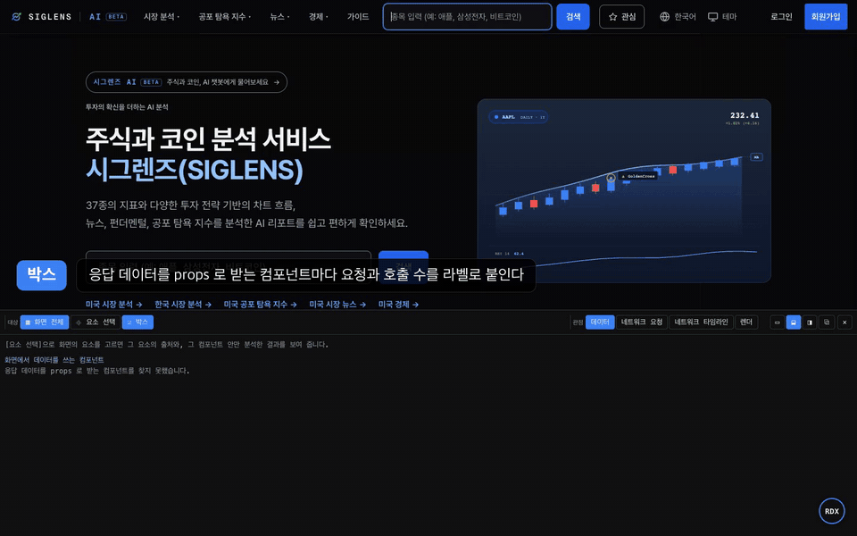
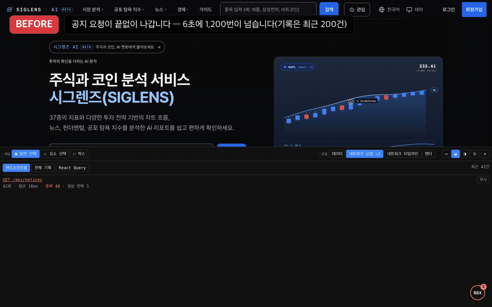
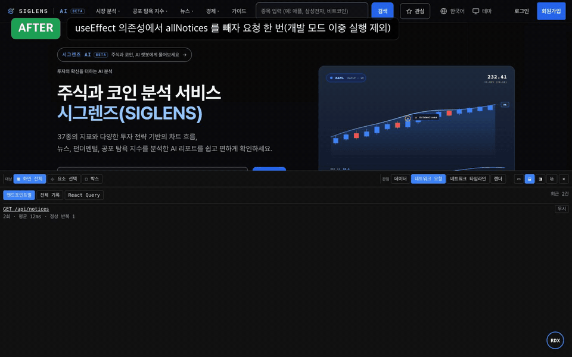
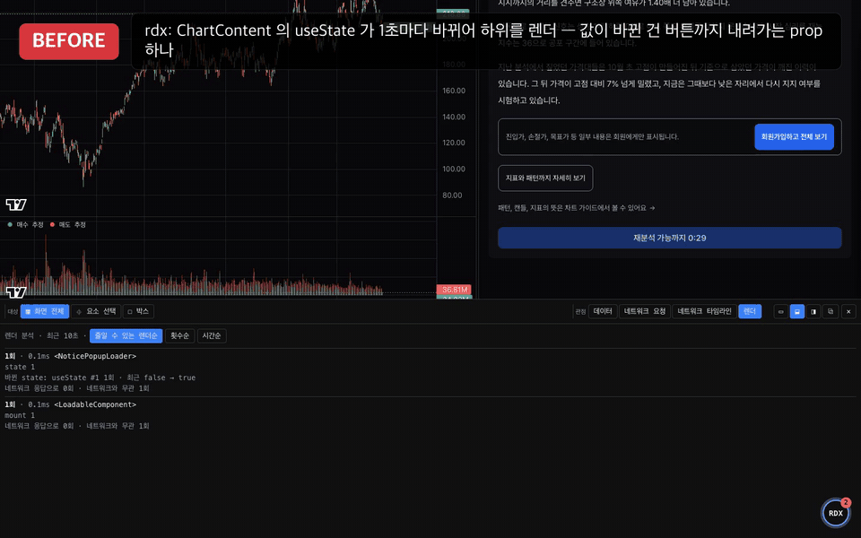
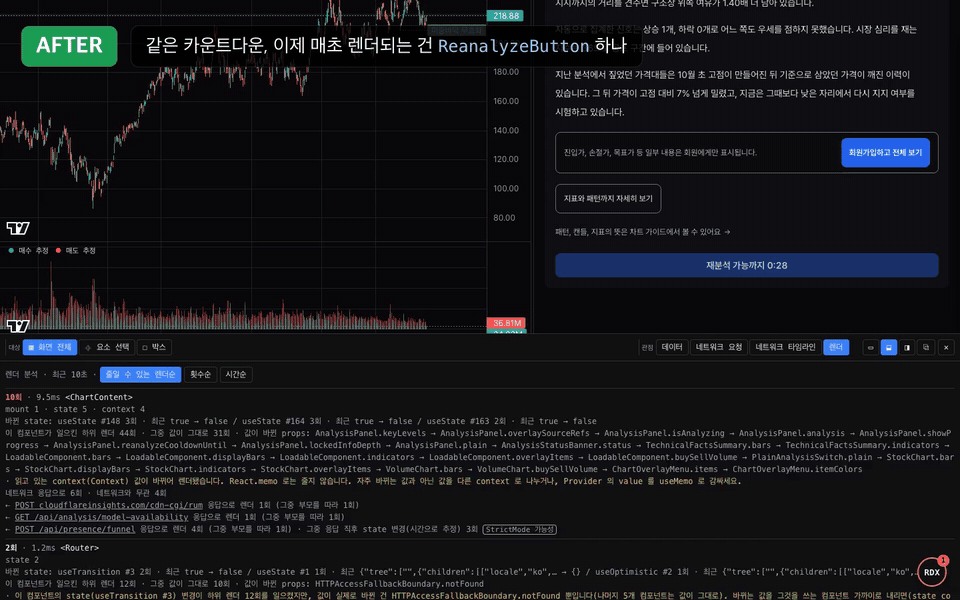

[English](./README.md)

<div align="center">

# react-data-xray (RDX)

**화면의 값을 클릭하면 어느 API 응답의 어느 필드인지 보여 주고,<br/>낭비되는 요청과 렌더를 찾아 주는 React 개발 도구**

[](#지원-환경)
[](./LICENSE)



</div>

Network 탭과 React DevTools 를 오가며 짐작하던 질문에, 개발 중인 화면 위에서 바로 답합니다.

- **이 값은 어디서 왔나**: 요소를 클릭하면 요청 URL, 응답 안의 위치(`$.data.summary.total`), React Query 키를 보여 줍니다.
- **같은 요청이 왜 또 나가나**: 엔드포인트별 호출 수와 중복, 같은 응답을 다시 받은 횟수를 세고 요청을 보낸 코드를 보여 줍니다.
- **왜 자꾸 렌더되나**: 바뀐 state 와 그 주기, 렌더를 일으킨 컴포넌트와 응답, 고치는 방법을 알려 줍니다.
- **React Query 캐시 키가 맞나**: 같은 요청을 다른 키로 캐시하거나, 키에 인자가 빠진 곳을 찾습니다.

처음 붙인 날 화면을 점검하거나, `reset` → 조작 → `snapshot` 으로 고치기 전후를 비교하거나, PR·QA 전에 낭비 요청과 렌더를 확인할 때 씁니다.

| 이미 쓰는 도구 | 보여 주는 것 | RDX 가 더하는 것 |
|---|---|---|
| Network 탭 | 어떤 요청이 나갔는지 | 그 응답을 화면의 어느 컴포넌트가 쓰는지 |
| React DevTools | props, state, 렌더 시간 | 그 값이 어느 요청에서 왔는지, 그 렌더를 일으킨 응답 |
| TanStack Query Devtools | 캐시에 든 쿼리와 키 | 어느 컴포넌트가 쓰는지, 키 설계가 잘못된 곳 |

## 지원 환경

- React 18, 19. 개발 서버에서만 동작(production 빌드에서는 아무것도 하지 않음)
- Vite, Create React App, Next.js App Router(15.3 이상). Pages Router 는 아직 확인하지 않았습니다.
- `fetch`, `XMLHttpRequest` 로 받은 JSON 응답. 데이터를 가져오는 라이브러리(React Query, SWR, axios, redux 등)는 가리지 않습니다.

## 시작하기

### 1. 설치

아직 npm 에 배포하기 전이라, 저장소를 받아 빌드한 뒤 앱에 연결합니다. 빌드에는 [pnpm](https://pnpm.io) 이 필요합니다.

```bash
git clone https://github.com/y0ngha/react-data-xray.git
cd react-data-xray && pnpm install && pnpm build

# 앱 폴더에서. 두 폴더를 나란히 뒀다면 경로는 ../react-data-xray
pnpm add -D file:../react-data-xray   # npm i -D file:../react-data-xray, yarn add -D file:../react-data-xray
```

### 2. 앱에 넣기

`import 'react-data-xray'` 로 요청과 렌더를 지켜보기 시작하고, `<RdxDevtools />` 로 화면 오른쪽 아래에 버튼과 패널을 띄웁니다. import 는 다른 import 보다 먼저 둡니다. 늦게 불러오면 그 전에 나간 요청과 렌더는 보지 못합니다.

```tsx
// main.tsx (Create React App 은 index.tsx)
import 'react-data-xray';
import { RdxDevtools } from 'react-data-xray';
import { createRoot } from 'react-dom/client';
import { App } from './App';

createRoot(document.getElementById('root')!).render(
  <>
    <App />
    <RdxDevtools />
  </>,
);
```

<details>
<summary><b>Next.js App Router</b></summary>

Next.js 에는 시작 파일이 없어서 `instrumentation-client.ts`(브라우저에서 React 보다 먼저 실행되는 파일)에 import 를 둡니다. `src` 폴더를 쓰지 않으면 경로에서 `src/` 를 빼세요.

```ts
// src/instrumentation-client.ts 맨 위에
import 'react-data-xray';
```

패널은 `'use client'` 인 Provider 안에 둡니다. 이미 Provider 파일이 있다면 한 줄만 더하면 됩니다.

```tsx
// src/app/providers.tsx: 루트 레이아웃이 <Providers>{children}</Providers> 로 감싼다
'use client';
import { RdxDevtools } from 'react-data-xray';

export function Providers({ children }: { children: React.ReactNode }) {
  return (
    <>
      {children}
      <RdxDevtools />
    </>
  );
}
```

</details>

### 3. 써 보기

1. 오른쪽 아래 **RDX** 버튼으로 패널을 엽니다.
2. 패널의 **⌖ Pick element**(<kbd>Ctrl</kbd>/<kbd>Cmd</kbd> + <kbd>Shift</kbd> + <kbd>D</kbd>)를 누르고, API 에서 받아 온 숫자나 글자를 클릭합니다.
3. 패널에 `GET /api/...` 와 `$[0].name` 같은 위치가 나오면 성공입니다. **Network**, **Renders** 탭으로 같은 컴포넌트를 다른 각도에서 봅니다.

<details>
<summary><b>잘 안 될 때</b></summary>

- **버튼이 안 보입니다**: `<RdxDevtools />` 가 실제로 그려지는 곳에 있는지, 개발 서버인지 확인합니다.
- **처음 나간 요청이 안 보입니다**: `import 'react-data-xray'` 가 다른 import 보다 앞에 있는지 확인합니다. Next.js 라면 `instrumentation-client.ts` 가 `app` 폴더와 같은 높이(`src` 를 쓰면 `src/` 안)에 있어야 합니다.
- **클릭해도 출처가 안 나옵니다**: 그 값이 JSON 응답에서 왔는지 확인합니다. 서버에서 그려 보낸 값은 이어지지 않습니다.
- **단축키가 브라우저와 겹칩니다**: 패널의 버튼을 쓰거나 `<RdxDevtools hotkey={{ key: 'x', shift: true }} />` 로 바꿉니다.

</details>

## 이런 문제를 찾습니다

### 응답 → 렌더 → 다시 요청, 끝나지 않는 고리

실제 서비스(Next.js 16, React 19)의 공지 팝업에서 `useEffect` 의존성에 그 effect 가 채우는 state 를 넣은 경우입니다. 응답이 올 때마다 state 가 바뀌어 effect 가 다시 돌고, 6초 동안 요청이 1,713번 나갔습니다.

<table>
  <tr>
    <td width="50%" align="center"><b>고치기 전</b></td>
    <td width="50%" align="center"><b>고친 뒤</b></td>
  </tr>
  <tr>
    <td></td>
    <td></td>
  </tr>
</table>

Network 탭은 같은 요청이 쌓이는 것만, React DevTools 는 팝업이 자주 렌더되는 것만 보여 줍니다. RDX 는 둘을 이어 "응답을 받을 때마다 이 컴포넌트가 렌더되고, 그 요청은 `useNoticePopup` 의 `useEffect` 에서 다시 나간다"고 짚습니다. → [전체 영상](./docs/media/rdx-effect-loop-before-after.mp4)

### 버튼 문구 하나에 화면 전체가 매초 렌더

같은 서비스에 실제로 있던 문제입니다. "재분석 가능까지 0:18" 버튼의 남은 시간을 위쪽 컴포넌트가 state 로 들고 1초마다 줄여서, 분석 패널 전체가 매초 렌더되고 있었습니다.

<table>
  <tr>
    <td width="50%" align="center"><b>고치기 전</b></td>
    <td width="50%" align="center"><b>고친 뒤</b></td>
  </tr>
  <tr>
    <td></td>
    <td></td>
  </tr>
</table>

RDX 는 "이 state 가 1초마다 바뀌는데 값이 실제로 바뀐 건 버튼까지 내려가는 prop 하나뿐이니, state 를 버튼 가까이로 내리라"고 짚었습니다. 그대로 고치자 10초 동안의 렌더가 80회에서 10회로 줄었습니다. → [전체 영상](./docs/media/rdx-cooldown-before-after.mp4)

### 보고서로 진단하고 AI 와 함께 고쳐 다시 측정

사내 관리 화면의 항목 100여 개짜리 트리에서, 체크박스 하나를 클릭하면 모든 행이 다시 렌더되고 있었습니다. rdx 보고서의 `startedRenders` 가 많고, `changedProps.newCallback` 이 반복 원인으로 잡혔습니다. AI 가 보고서를 읽고 행을 `memo` 로 감싸고 콜백·객체 참조를 고정하는 수정을 제안했고, 고친 뒤 같은 시나리오를 다시 측정했습니다(dev 빌드).

| | 고치기 전 | 고친 뒤 |
|---|---|---|
| 체크박스 클릭 한 번의 렌더+commit (평균) | 15.8 ms | 7.4 ms |

측정은 `window.__RDX__.reset()` → 체크박스 클릭 → `window.__RDX__.snapshot('before')` / `snapshot('after')` 순서로 했습니다(패널 도구 막대의 **Measure** 를 펼쳐 Clear records → Save → Compare 로도 할 수 있습니다). 자세한 워크플로는 아래 [AI 에이전트와 함께 쓰기](#ai-에이전트와-함께-쓰기) 절을 보세요.

### 기존 대형 앱에 붙이자마자 나온 중복 요청

React 18 + Vite 로 된 서비스(레거시 `fetch` 와 React Query 혼용)에 rdx 를 붙이고 처음 연 화면에서 중복 요청 두 건의 원인이 바로 나왔습니다. 하나는 effect 의존성이 바뀌어 같은 요청이 다시 나간 것(늦게 도착한 값으로 만든 콜백), 다른 하나는 부모의 로딩 분기 때문에 자식이 재마운트되어 마운트 effect 의 요청이 두 번 나간 것입니다. 새 프로젝트용이 아니라 기존 코드에서 붙인 당일부터 쓸 수 있습니다.

## AI 에이전트와 함께 쓰기

rdx 보고서를 AI 가 읽게 내보내면, AI 가 측정 → 원인 확인 → 수정 → 다시 측정 순서로 일합니다. 브라우저 콘솔이나 AI 도구에서 아래 세 단계를 씁니다.

```js
window.__RDX__.reset();                  // 기록을 지우고 측정 새로 시작
// … 화면을 조작합니다 …
await window.__RDX__.snapshot('before'); // .rdx/before.json 으로 저장
```

Claude Code 를 쓴다면 패키지의 스킬 [`rdx-perf`](./skills/rdx-perf/SKILL.md) 를 복사해 두세요. "이 화면 느려" 같은 요청에 위 순서로 자동으로 일합니다. 자세한 내용은 [AI 에이전트와 함께 쓰기](./docs/ai.md) (영어)를 보세요.

## 문서

- [화면 둘러보기](./docs/guide.md) (영어): 박스, 요소 선택, 네트워크, 렌더, React Query 캐시 점검, 패널 쓰기 팁
- [AI 에이전트와 함께 쓰기](./docs/ai.md) (영어): `window.__RDX__`, `.rdx/report.json` 보고서, Claude Code 스킬

## 알아 둘 것

- 기록은 브라우저와 내 개발 서버에만 남고 다른 곳으로 보내지 않습니다.
- JSON 응답만 화면 요소와 이어집니다. Next.js 의 서버 컴포넌트, Server Action 으로 받은 데이터는 요청 목록에만 나옵니다. 같은 앱에서도 브라우저가 `fetch` 로 받는 데이터(검색, React Query 등)는 이어집니다. WebSocket, SSE, Service Worker 안의 요청은 보지 않습니다.
- 응답을 `map` 등으로 가공해 state 에 넣으면 같은 객체로 이을 수 없어서, 응답이 도착한 직후에 바뀐 state 를 그 응답 때문이라고 추정합니다. 우연히 겹친 렌더가 붙을 수 있습니다.
- 요청을 보낸 코드의 원래 파일 위치는 Vite 처럼 파일을 하나씩 보내는 개발 서버에서만 보여 줍니다. webpack, Turbopack 에서는 함수 이름으로 찾으세요.
- 컴포넌트를 렌더한 JSX 위치는 개발 빌드에서만 나옵니다. React 19 는 개발 서버가 변환한 코드의 줄을 소스맵으로 원본 줄로 바꾸므로, 소스맵을 받기 전 잠깐은 변환된 줄이 보일 수 있습니다.

## 기여

개발 환경과 규칙은 [CONTRIBUTING.md](./CONTRIBUTING.md)에 있습니다.

## 라이선스

[MIT](./LICENSE)
