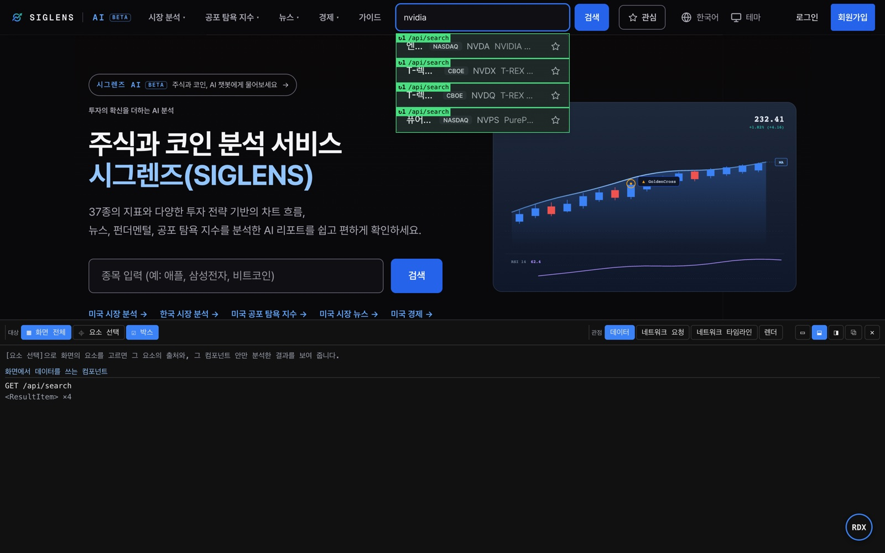
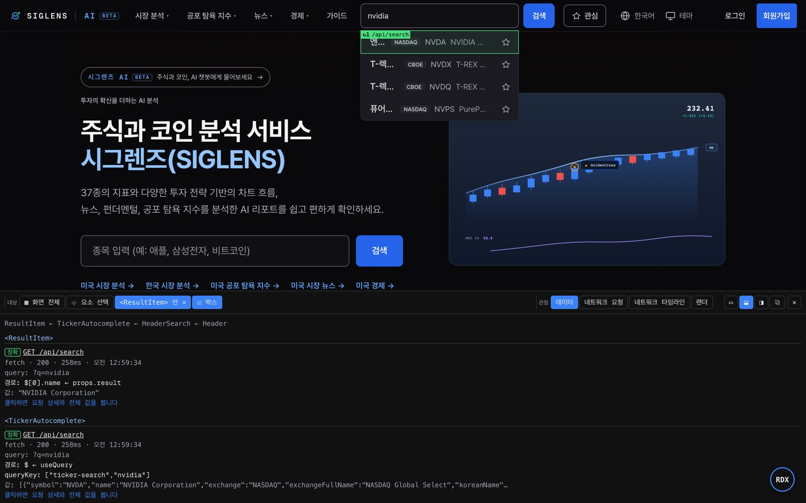
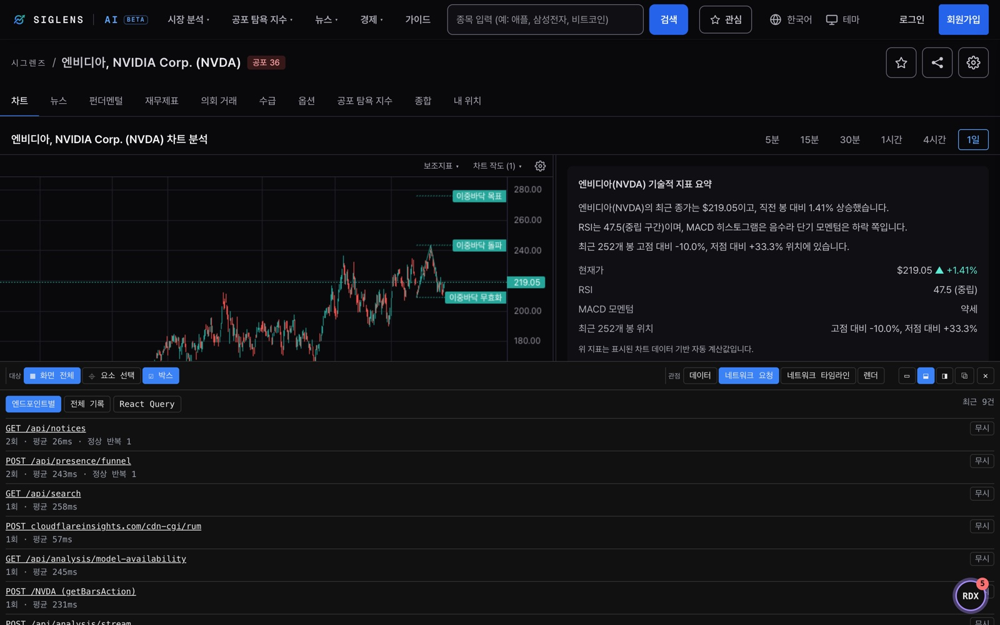
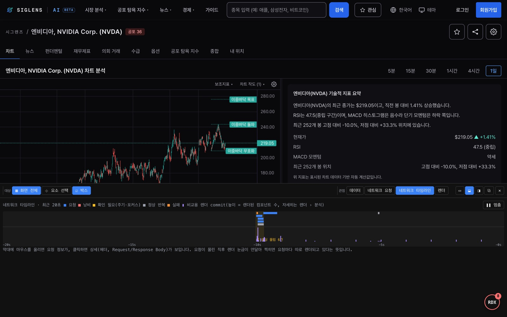
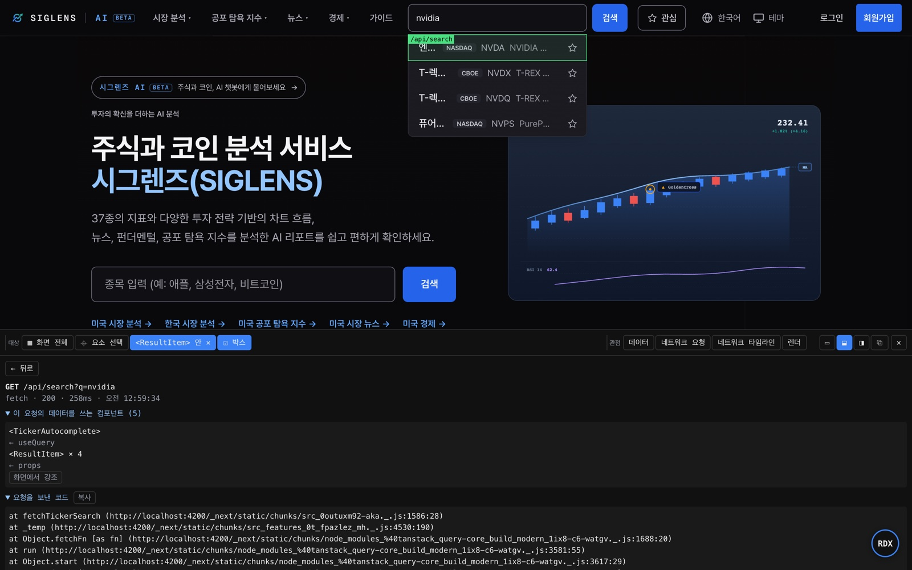
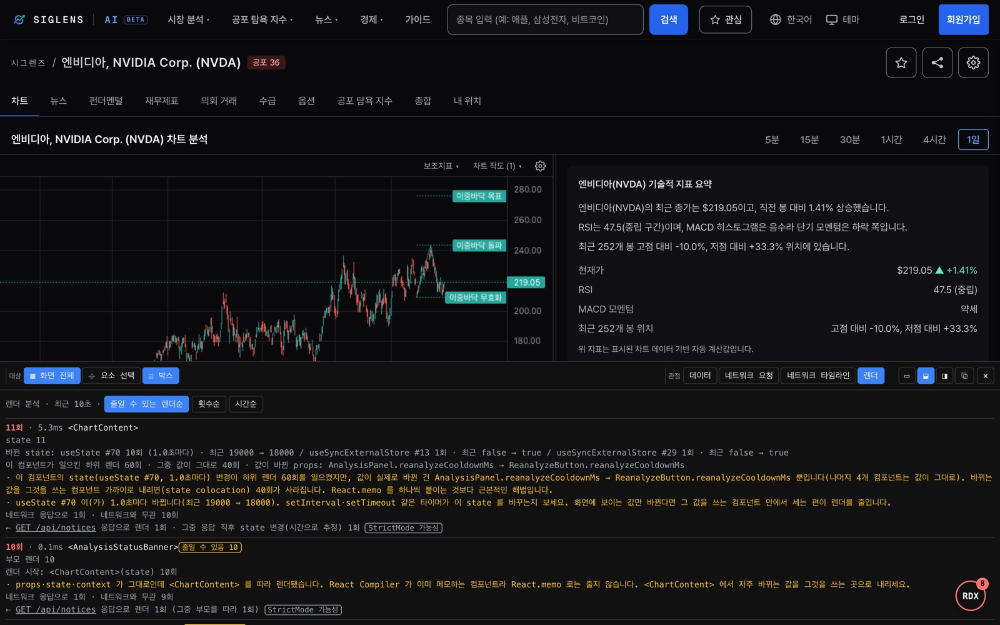
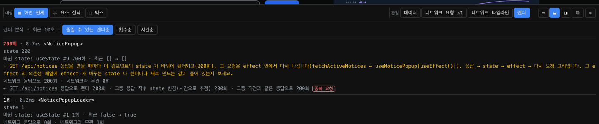
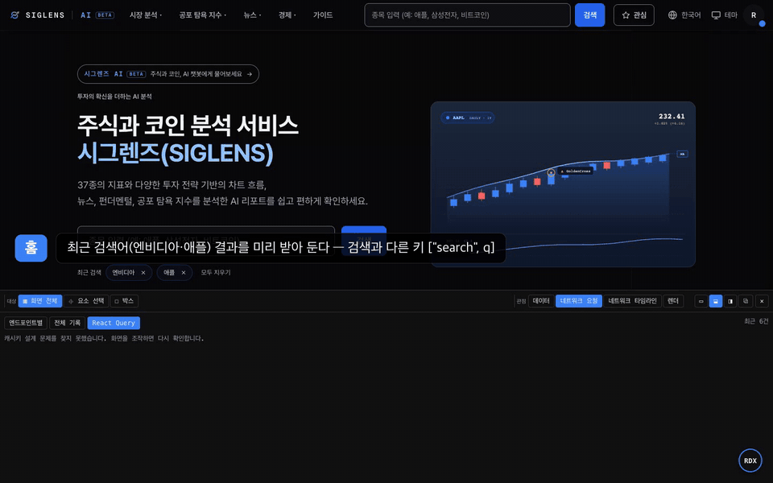
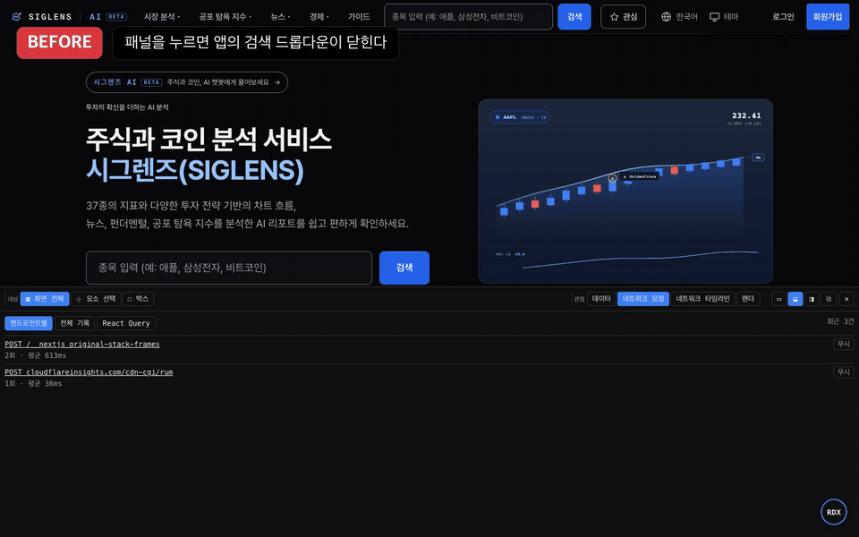

# RDX UI Tour

Back to [README](../README.md)

> See the [feature tour video (45s)](./media/rdx-feature-tour.mp4) for an end-to-end walkthrough.

The toolbar at the top of the panel has two rows.

**Row 1** — always visible, four groups separated by a border:

- **Target**: what to look at. Default is **▦ Whole page**. Use **⌖ Pick element** to select a single component and scope everything to it. **☐ Boxes** draws labels on the page.
- **View**: choose between **Data · Network Requests · Network Timeline · Renders**.
- **Measure**: toggle to show the measurement row below. Shows `since HH:MM` when a reset has happened.
- **Window** (far right): display mode icons and **✕** close.

**Row 2** — visible only when **Measure** is expanded:

**Clear records** (+ time since reset) › **Save** (enter a name, press Save or Enter) › **Compare** (pick two snapshots to diff) › **Copy report path** (copies the path to this tab's report for sharing with an AI agent).

Select a component, then switch views — only the requests used by that component and its renders remain.

## Boxes: labeling components that use response data



Draws a border and label on every component that receives response data as props.

```
GET /api/projects  req ×6 · duplicates 2 · same response 3   renders: 12 · avoidable: 9
```

- `req ×6`: this request was sent 6 times. `duplicates 2` is the count of repeat requests within 2s; `same response 3` is the count where the response was identical to the previous one.
- `renders: 12 · avoidable: 9`: components using this response rendered 12 times in the last 10s; 9 were avoidable — renders where props, state, and context were unchanged but the component re-rendered with its parent, or received a new object or function with the same content.
- Border color: green = exact response data used as-is, blue = derived (transformed but values match), red = the request providing that data is wasteful. Flashes purple on each render.

## Pick element: which response field is this text from?



Finds the nearest component that holds response data and shows the request, sent values, path inside the response, value, and React Query key. The confidence level is one of three:

| Label | Meaning |
|---|---|
| `exact` | The component received the response object directly |
| `derived` | A transformed object, but field values match a response item |
| `guessed` | A text value on screen matches something inside the response. May be coincidence — used as a last resort |

## Network: endpoint waste and timeline

<table>
  <tr>
    <td width="50%"></td>
    <td width="50%"></td>
  </tr>
  <tr>
    <td align="center"><sub><b>Network Requests</b>: per-endpoint count · duplicates · same responses · avg response time</sub></td>
    <td align="center"><sub><b>Network Timeline</b>: requests and render commits over the last 20s, with burst and failure markers</sub></td>
  </tr>
</table>

Repeats that have a reason are shown separately rather than counted as waste: regular polling, automatic refetch when the window regains focus, bursts during initial load, and React running effects twice in development (StrictMode). Without this, persistent red markers would hide real problems.

Next.js Server Actions all go to the page URL, but rdx splits them by function name (`POST /NVDA (getBarsAction)`).

Click a request to open **request detail**: headers, body, caller code, and components that use the response.



## Renders: what rendered, why, and caused by what?



Shows components that rendered most in the window — since the last **Clear records** (up to 2 min), or the last 10s if no reset has happened — sorted by most avoidable renders first.

- **Changed state**: which hook changed and from what to what (`useState #70 · 22000 → 21000`). A regular interval signals a timer. `#70` is the call order of the hook in that component, counting hooks inside custom hooks too.
- **What caused the render**: an ancestor component, and the response that triggered it. If the response was transformed before being stored in state, the link is made by timing ("right after response").
- **Impact started from this component**: child render count, how many had unchanged values, and which props actually changed.
- **How to fix**: if the changed value is narrow, move state closer to it. If an effect re-sends a request after every response, check its dependencies. `React.memo` is not suggested for components compiled by React Compiler.

A cycle where every response triggers a render that re-sends the request is diagnosed like this:



## React Query cache key audit



**Network Requests › React Query** finds cache key design mistakes. No app code changes needed — rdx locates the `QueryClientProvider` on the page and observes it.

| Finding | What went wrong |
|---|---|
| Same request cached under different keys | Two `queryKey`s receive the same request separately, splitting the cache and sending the request twice |
| Different requests fetched under the same key | A value the query function uses (search term, filter) is missing from `queryKey`; data from different conditions overwrites the same cache entry |
| staleTime is 0 — same response fetched again | The same response is fetched again every time the component re-appears or the window regains focus |
| No query matched the invalidated key | The key passed to `invalidateQueries` matched no query on this page. After an optimistic update, a wrong key means the UI never reverts to the server value. The call site is shown alongside the finding |

There are limits inherent to how findings are detected.

- The first three findings work by comparing cached data against JSON responses from `fetch`/XHR. Queries populated via non-JSON responses (e.g. Server Actions) are not audited.
- The invalidation finding compares only against queries created on this page so far. Pre-invalidating a query for another page will produce a finding that can be safely ignored.

The animation shows four intentional mistakes added to a real service's search and watchlist features, used normally. The first mistake was caught once per search term — five findings total. The original code with the mistakes removed produced no findings. → [Full video](./media/rdx-react-query-audit.mp4)

## Panel tips



- **Display mode**: choose Small (▭), Dock bottom (⬓), Dock right (◨), or Undock (⧉) from the top-right of the panel. When docked, drag the inner edge to resize. The RDX button can also be dragged.
- **Coexisting with the app**: clicking the panel does not close app dropdowns or steal focus from inputs. When a modal opens, the docked panel collapses to its toolbar only. Click **Expand** to restore it. → [Before/after video](./media/rdx-panel-ux-before-after.mp4)
- **Persists across reloads** (same tab): panel state and request records. Response bodies are saved up to 100KB; cleared when the tab closes. Values whose names contain words like token, password, or authorization are stored as `(redacted)`, but detection is name-based so not every secret value is guaranteed to be redacted.
- **Persists across tabs**: display mode, button position, ignore list (endpoints marked as intentional repeats).
- **Button count**: current problem count (endpoints with wasted requests + components with a render storm). Briefly changes color when a new problem appears.
